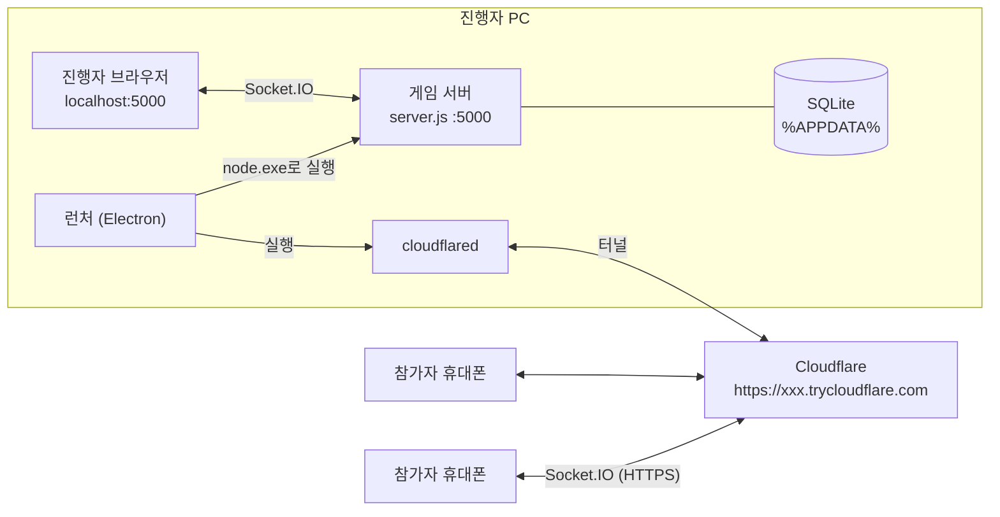
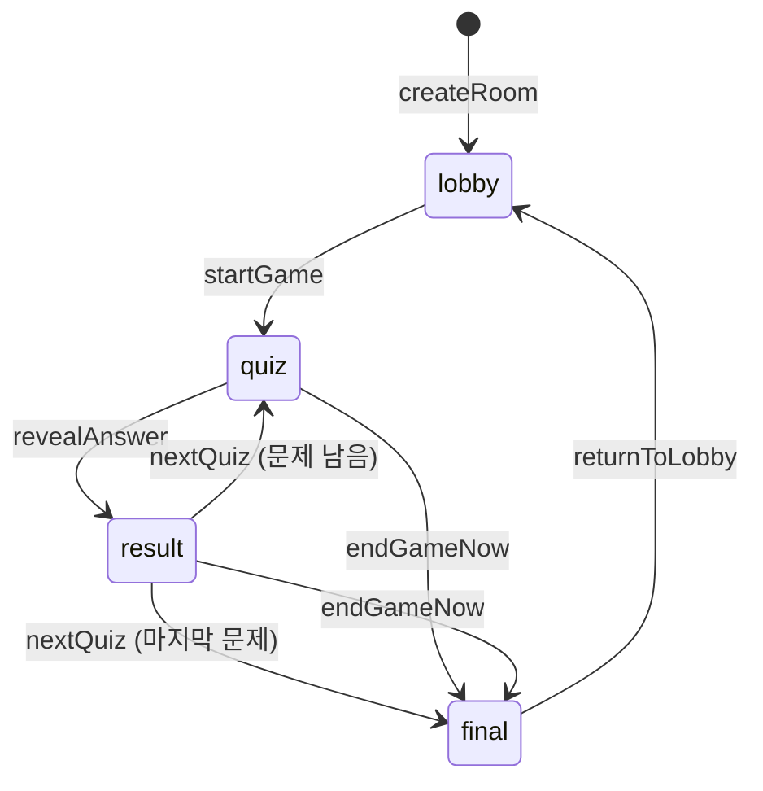
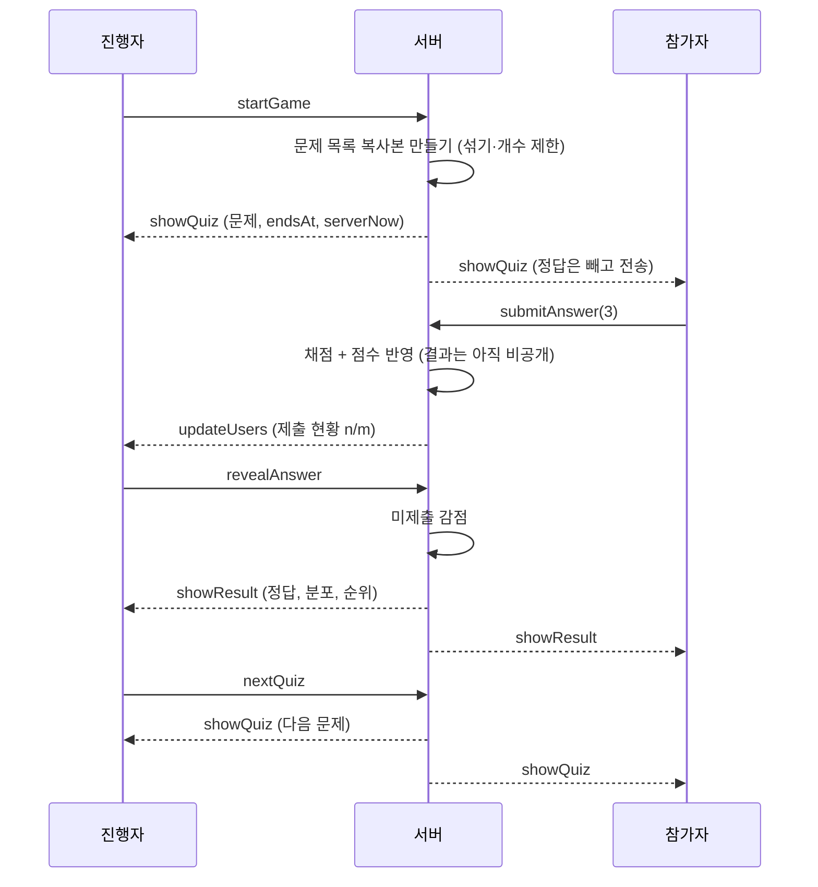
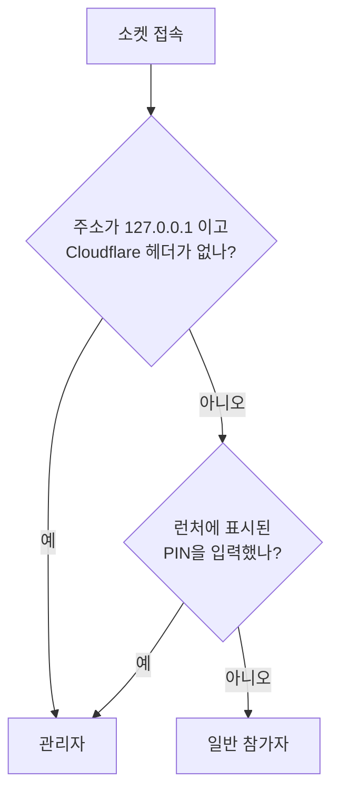
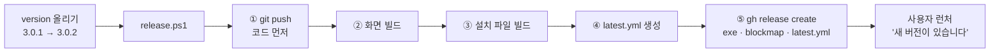

# SAFETY QUIZ (QuizLive)

진행자 PC 한 대로 여는 **실시간 참여형 퀴즈**입니다.
진행자가 런처로 서버를 켜면 인터넷 접속 주소와 QR 코드가 만들어지고, 참가자는 휴대폰으로 QR을 찍어 바로 참여합니다.
수련회 레크리에이션처럼 수십 명이 한 화면(프로젝터)을 보며 함께 푸는 상황을 위해 만들었습니다.

- **진행자 화면**: 프로젝터용 큰 화면 (문제, 타이머, 제출 현황, 정답 분포, 순위)
- **참가자 화면**: 휴대폰 리모컨 (보기 누르면 바로 제출)
- **문제 유형**: 객관식 · OX · 주관식 · 밸런스게임, 사진·동영상 첨부
- **설치형 런처**: 서버 실행, 외부 접속 주소 자동 생성, 데이터 백업·복원, 자동 업데이트

---

## 목차

1. [기술 스택](#1-기술-스택)
2. [전체 구조](#2-전체-구조)
3. [폴더와 파일](#3-폴더와-파일)
4. [게임이 진행되는 흐름](#4-게임이-진행되는-흐름)
5. [소켓 이벤트 목록](#5-소켓-이벤트-목록)
6. [핵심 설계 포인트](#6-핵심-설계-포인트)
7. [데이터 저장](#7-데이터-저장)
8. [런처](#8-런처)
9. [배포와 자동 업데이트](#9-배포와-자동-업데이트)
10. [개발 환경](#10-개발-환경)
11. [테스트](#11-테스트)
12. [실제로 겪은 문제와 해결](#12-실제로-겪은-문제와-해결)
13. [버전 기록](#13-버전-기록)

---

## 1. 기술 스택

| 영역 | 사용 기술 | 이유 |
| --- | --- | --- |
| 화면 | React 19, Vite | 화면 단위(대기실·문제·결과)로 컴포넌트를 나누기 쉬움 |
| 실시간 통신 | Socket.IO | 서버가 모든 참가자에게 "다음 문제"를 동시에 밀어줘야 함. 끊기면 자동 재연결 |
| 서버 | Node.js, Express | 화면 파일 제공 + 파일 업로드 + 소켓 서버를 한 프로세스로 |
| 저장소 | SQLite (better-sqlite3) | 설치가 필요 없는 파일 하나짜리 DB. PC 한 대에서 쓰기에 충분 |
| 외부 접속 | Cloudflare Quick Tunnel | 공유기 설정 없이 `https://xxx.trycloudflare.com` 주소를 바로 발급 |
| 데스크톱 앱 | Electron, electron-builder | 서버를 버튼 하나로 켜고 끄는 윈도우 프로그램 + 설치 파일 생성 |
| 자동 업데이트 | electron-updater + GitHub Releases | 새 버전을 올리면 사용자 런처에서 버튼 한 번으로 업데이트 |
| 폰트 | Pretendard, Space Grotesk | npm 패키지로 앱 안에 포함 → 인터넷이 없어도 같은 모양 |

---

## 2. 전체 구조



- 서버는 **화면 파일(`client/dist`)도 함께 제공**합니다. 참가자는 앱 설치 없이 브라우저로 접속합니다.
- 진행자는 같은 PC의 `localhost`로 접속하고, 참가자는 Cloudflare 주소로 접속합니다.
  이 차이로 **"서버 PC에서 온 접속인가?"** 를 판단해 관리자 권한을 줍니다 ([6-1](#6-1-누가-관리자인가)).

---

## 3. 폴더와 파일

```
QuizLive_v3
├─ client/                 화면 (React)
│  └─ src/
│     ├─ App.jsx           화면 전환, 소켓 이벤트 수신, 재접속 처리 (앱의 "두뇌")
│     ├─ socket.js         소켓 연결, 탭별 비밀 키, request() 헬퍼
│     ├─ styles.css        테마 A "Dark Arcade" 전체 스타일 (색은 맨 위 변수만 바꾸면 됨)
│     ├─ utils/
│     │  ├─ hooks.js       useCountdown(서버 시각 기준 타이머), 보기 목록 만들기
│     │  └─ dialog.js      알림·확인·PIN 입력 창 (sweetalert2)
│     └─ components/
│        ├─ Home.jsx       참가하기 / 방 만들기
│        ├─ Lobby.jsx      대기실 (진행자: 참여코드·QR·참가자·강퇴 / 참가자: 대기)
│        ├─ Quiz.jsx       문제 화면 (HostQuiz: 프로젝터용 / PlayerQuiz: 휴대폰용)
│        ├─ QuizParts.jsx  타이머 링·바, 사진·영상, 문제 번호 같은 공용 조각
│        ├─ Result.jsx     정답 공개 (진행자: 분포·순위 / 참가자: 정답·오답)
│        ├─ Final.jsx      최종 순위 (시상대)
│        ├─ CreateQuiz.jsx 문제 관리 (추가·수정·복사·삭제·검색)
│        └─ GameSettings.jsx 게임 설정
├─ server/
│  └─ server.js            게임 서버 전체 (방·점수·타이머·권한·DB·업로드)
├─ launcher/               윈도우 런처 (Electron)
│  ├─ main.js              서버·터널 실행, 백업·복원, 자동 업데이트
│  ├─ preload.js           화면(renderer)이 쓸 수 있는 기능만 골라서 열어줌
│  ├─ renderer.js          런처 화면 동작
│  ├─ launcher.html        런처 화면
│  ├─ build/icon.ico       앱·설치 파일 아이콘 (icon.png는 원본 이미지)
│  └─ cloudflare.js        cloudflared 실행 후 주소 읽기
├─ scripts/
│  └─ make-latest-yml.js   자동 업데이트용 latest.yml 생성
├─ tests/                  서버 로직 테스트 (51개)
├─ load-test/              봇 여러 명 동시 접속 부하 테스트
├─ setup-v3.ps1            처음 준비 (v2에서 실행 파일 복사 + 패키지 설치)
└─ release.ps1             새 버전 배포 (빌드 → GitHub Releases 업로드)
```

---

## 4. 게임이 진행되는 흐름

### 4-1. 방의 상태 (phase)

방은 항상 아래 네 상태 중 하나이고, **서버만 상태를 바꿀 수 있습니다.** 화면은 서버가 보내준 상태를 그대로 보여주기만 합니다.



### 4-2. 한 문제가 진행되는 과정



---

## 5. 소켓 이벤트 목록

### 화면 → 서버 (요청)

모든 요청은 `request(이벤트, 데이터)`로 보내고 `{ success, message, ... }`로 응답받습니다.

| 이벤트 | 누가 | 하는 일 |
| --- | --- | --- |
| `adminLogin` | 누구나 | 관리자 PIN 확인 → 관리자 권한 + 업로드용 토큰 발급 |
| `createRoom` | 관리자 | 방 만들기 |
| `joinRoom` | 누구나 | 참여코드로 입장 |
| `rejoinRoom` | 본인 | 새로고침·재연결 후 원래 자리로 복귀 |
| `updateRoomSettings` | 방장 | 게임 설정 저장 |
| `getQuizzes` | 관리자 | 문제 목록 (정답 포함) |
| `addQuiz` `updateQuiz` `deleteQuiz` `deleteAllQuizzes` | 관리자 | 문제 관리 |
| `resetUsedQuizHistory` | 방장 | "출제됨" 기록 초기화 |
| `startGame` `revealAnswer` `nextQuiz` `endGameNow` `returnToLobby` | 방장 | 진행 |
| `kickPlayer` | 방장 | 참가자 내보내기 |
| `submitAnswer` | 참가자 | 답 제출 |
| `leaveRoom` | 본인 | 나가기 (방장이 나가면 방 종료) |

### 서버 → 화면 (알림)

| 이벤트 | 내용 |
| --- | --- |
| `updateUsers` | 참가자 목록 (공개 ID, 닉네임, 점수, 제출 여부, 연결 여부) |
| `showQuiz` / `showResult` / `gameEnd` / `backToLobby` | 화면 전환 |
| `updateSettings` `updateQuizUsage` `updateQuizzes` | 설정·출제 기록·문제 목록 변경 |
| `adminStatus` `publicUrl` | 관리자 여부, 참가용 Cloudflare 주소 (관리자에게만) |
| `hostStatus` | 방장 연결이 끊겼는지 (참가자 화면에 안내 띠 표시) |
| `kicked` `sessionMoved` `roomClosed` | 강퇴됨, 다른 탭이 자리를 가져감, 방 종료 |

---

## 6. 핵심 설계 포인트

### 6-1. 누가 관리자인가

문제를 보고, 고치고, 지우는 건 **관리자만** 할 수 있습니다. 참가자에게는 정답이 들어 있는 문제 목록 자체를 보내지 않습니다.



- Cloudflare를 거친 접속도 서버 입장에서는 `127.0.0.1`(같은 PC의 cloudflared)에서 온 것처럼 보입니다.
  그래서 Cloudflare가 붙이는 `cf-connecting-ip` 같은 헤더가 **있으면 외부 접속**으로 판단합니다. (`isLocalRequest`)
- 다른 기기(태블릿 등)에서 진행하려면 런처의 6자리 PIN을 입력합니다. PIN은 런처를 켤 때마다 새로 만들어집니다.
- 파일 업로드는 소켓이 아니라 HTTP라서, PIN 로그인 때 받은 토큰을 `x-admin-token` 헤더로 보냅니다.

### 6-2. 공개 ID와 비밀 키를 나눈 이유

각 참가자는 두 가지 값을 가집니다.

| 값 | 누가 아나 | 용도 |
| --- | --- | --- |
| `id` (공개 ID) | 모두 | 화면 표시, 강퇴 대상 지정, 결과에서 "나" 찾기 |
| `key` (비밀 키) | 그 브라우저 탭만 | 새로고침 후 "제가 아까 그 사람이에요" 증명 |

> **v3.0.0의 보안 버그**: 처음에는 비밀 키를 ID로 그대로 썼습니다.
> 참가자 목록은 모든 사람에게 전송되므로, 참가자가 **방장의 키를 보고 방장 자리로 "재접속"** 할 수 있었고,
> 방장은 관리자이므로 문제 전체 삭제까지 가능했습니다. v3.0.1에서 둘을 분리하고,
> "방장 비밀 키가 참가자에게 전송되지 않는다"를 테스트로 확인합니다.

### 6-3. 재접속 (새로고침·화면 꺼짐)

휴대폰은 화면이 꺼지면 연결이 끊기는 일이 흔합니다. 끊겨도 점수와 자리가 유지되도록 만들었습니다.

1. 탭마다 비밀 키를 만들어 `sessionStorage`에 저장합니다. 새로고침해도 유지되고, 탭마다 따로라서 한 PC에서 여러 탭으로 테스트해도 섞이지 않습니다.
2. 소켓이 (다시) 연결될 때마다 `rejoinRoom`을 보냅니다.
3. 서버는 그 사람의 자리를 찾아 **지금 방 상태 전체(snapshot)** 를 돌려줍니다. 화면은 그걸 보고 대기실, 문제, 결과 중 맞는 화면으로 바로 이동합니다. 이미 답을 냈다면 "제출 완료" 상태로 복원됩니다.

연결이 끊긴 사람을 언제 내보내는지:

| 상황 | 참가자 | 방장 |
| --- | --- | --- |
| 대기실 · 최종 순위 | 90초 뒤 제거 | 3분 뒤 방 종료 |
| **게임 진행 중** | **최대 30분 유지** | **최대 30분 유지** |

> v3.0.0에서는 게임 중에도 90초 뒤 제거되어, 진행자가 설명하는 동안 휴대폰을 내려놓으면 점수가 사라졌습니다.

같은 비밀 키로 다른 탭이 접속하면(탭 복제 등) 이전 탭에는 `sessionMoved`를 보내 홈으로 돌려보냅니다.

### 6-4. 모두가 같은 타이머를 보는 방법

각 휴대폰의 시계는 조금씩 다르고, 늦게 들어온 사람도 있습니다. 그래서 "20초"가 아니라 **종료 시각**을 보냅니다.

```
서버가 보내는 값:  endsAt (문제가 끝나는 서버 시각), serverNow (보낸 순간의 서버 시각)

받은 순간:        offset = serverNow - 내 기기 시각
남은 시간:        endsAt - (내 기기 시각 + offset)
```

`useCountdown` 훅이 이 계산을 0.2초마다 합니다. 판정은 항상 **서버 시각 기준**이며, 네트워크 지연을 고려해 0.8초의 여유(`SUBMIT_GRACE_MS`)를 둡니다.

### 6-5. 채점

| 항목 | 규칙 |
| --- | --- |
| 정답 점수 | `baseScore` (기본 100점) |
| 빠른 정답 보너스 | `round(남은 시간 / 전체 시간 × speedBonusMax)` |
| 미제출 감점 | 정답 공개 시점에 안 낸 사람에게 적용 (밸런스게임 제외) |
| 밸런스게임 | 정답·점수 없음, 선택 비율만 공개 |
| 주관식 | 띄어쓰기·문장부호·대소문자 무시, `\|`로 여러 정답 등록 (`회복자세 \| 회복 자세`) |

- 제출 직후에는 정답 여부를 알려주지 않습니다. 옆 사람 화면을 보고 답을 따라 하는 걸 막기 위해서예요.
- 게임을 시작할 때 문제 목록의 **복사본**을 만들어 씁니다. 그래서 게임 중에 문제를 수정하거나 삭제해도 진행 중인 게임은 영향을 받지 않습니다.

### 6-6. 서버가 죽지 않게 하는 장치

모든 소켓 이벤트는 `on()` 함수로 감싸서 등록합니다.

- 응답 콜백이 없는 요청이 와도 오류가 나지 않습니다. v2에서는 콜백 없는 요청 하나로 서버 전체가 꺼질 수 있었습니다.
- 처리 중 예외가 나면 서버를 끄는 대신 그 요청에만 오류로 응답합니다.
- 관리자 전용 이벤트는 `{ admin: true }` 옵션 하나로 권한을 검사합니다.

### 6-7. 강퇴

방장이 대기실의 이름 옆 `×`, 또는 결과 화면 순위표에서 마우스를 올리면 나오는 `×`를 누르면 그 참가자를 내보냅니다.
내보낸 사람의 비밀 키는 `bannedKeys`에 기록되어 **같은 브라우저로는 다시 들어올 수 없습니다.**

---

## 7. 데이터 저장

문제와 업로드 파일은 프로그램 폴더가 아니라 **`%APPDATA%\SAFETY QUIZ`** 에 저장됩니다. 업데이트·재설치해도 지워지지 않습니다.

```
%APPDATA%\SAFETY QUIZ
├─ quizlive.db      문제(quizzes), 게임 설정(app_settings)
├─ uploads\         문제에 첨부한 사진·동영상
└─ logs\server.log  서버 로그 (5MB 넘으면 새로 시작)
```

- 표(table) 구조가 바뀌어도 기존 DB가 깨지지 않도록 `addColumnIfNotExists`로 **빠진 칸만 추가**합니다.
- 방, 참가자, 점수는 메모리에만 있습니다. 서버를 끄면 진행 중인 게임은 사라집니다.

---

## 8. 런처

| 기능 | 동작 |
| --- | --- |
| 서버 시작 | 내장 `runtime\node.exe`로 `server.js` 실행. 데이터 폴더와 관리자 PIN은 환경변수로 전달 |
| 외부 주소 | `cloudflared`로 Quick Tunnel을 열고, 받은 주소를 서버에 알려줌(`/api/public-url`) → 진행자 대기실에 QR 표시 |
| 관리자 PIN | 런처를 켤 때마다 6자리 생성, 화면에 표시 |
| 백업·복원 | DB + 업로드 폴더를 ZIP으로. 복원 전에 서버를 끄고, 실패하면 원래 상태로 되돌림 |
| 자동 업데이트 | 켜고 3초 뒤 GitHub에서 새 버전 확인 → 받기 → 서버 종료 후 설치·재시작 |

`preload.js`는 런처 화면이 **필요한 기능만** 쓸 수 있게 골라서 열어주는 창구입니다. 화면 코드가 PC의 파일이나 프로세스를 직접 건드리지 못하게 하는 Electron의 보안 구조예요.

---

## 9. 배포와 자동 업데이트



### 배포하는 법

1. `launcher/package.json`의 `"version"`을 올립니다.
2. v3 폴더에서 실행합니다.
   ```powershell
   powershell -ExecutionPolicy Bypass -File .\release.ps1
   ```
3. "이번 버전에서 바뀐 점"을 입력합니다. 이 내용은 런처의 업데이트 칸에 표시됩니다.

### 릴리스에 올라가는 파일

| 파일 | 용도 |
| --- | --- |
| `SAFETY-QUIZ-Setup-x.y.z.exe` | 설치 파일. 처음 설치하는 사람은 이것만 받으면 됨 |
| `latest.yml` | 런처가 읽는 "최신 버전 정보" (버전, 파일 이름, sha512 지문). **없으면 자동 업데이트가 안 됨** |
| `….exe.blockmap` | 설치 파일을 조각낸 지문 목록. 다음 업데이트 때 **바뀐 조각만** 받게 해줌 |

### 왜 이 순서인가 (v3.0.0에서 배운 것)

- **코드를 먼저 push**: 릴리스를 만들 때 태그가 GitHub의 최신 코드에 붙습니다. 코드를 나중에 올리면 태그가 이전 코드를 가리킵니다.
- **업로드는 gh CLI로**: electron-builder의 자체 업로드가 154MB 파일을 올린 뒤 중간에 실패해서, `latest.yml`이 빠진 릴리스가 만들어진 적이 있습니다. 지금은 빌드만 electron-builder로 하고, `latest.yml`은 스크립트가 직접 만들고, 업로드는 `gh`로 합니다.

---

## 10. 개발 환경

### 처음 준비

v2 폴더와 같은 위치에 v3 폴더를 두고:

```powershell
powershell -ExecutionPolicy Bypass -File .\setup-v3.ps1
```

v2에서 `node.exe`, `cloudflared.exe`, 서버 패키지를 복사하고(용량이 커서 git에는 올리지 않음) 나머지 패키지를 설치합니다.

### 실행

```powershell
# 런처로 전체 실행
cd launcher
npm start

# 화면만 고칠 때 (수정하면 바로 반영)
cd server; node server.js        # 창 1
cd client; npm run dev           # 창 2 → http://localhost:5173
```

### 테마 바꾸기

`client/src/styles.css` 맨 위의 `:root` 변수만 바꾸면 전체 색이 바뀝니다.

```css
--bg: #0e0f1a;       /* 배경 */
--accent: #c6ff3d;   /* 강조색 (선택, 정답, 주요 버튼) */
--c1 ~ --c4          /* 보기 1~4 색 */
```

---

## 11. 테스트

```powershell
node --no-warnings tests/server.test.js
```

실제 네트워크 없이 가짜 브라우저 여러 개를 만들어 서버 로직을 검증합니다. 2초 안에 끝나고, 현재 **51개 항목**을 확인합니다.

- 권한: 외부 참가자는 문제 조회·추가·삭제·방 생성 불가, PIN 로그인 후 가능
- 보안: 방장 비밀 키 비전송, 공개 ID로 방장 탈취 불가
- 안정성: 콜백 없는 요청에도 서버 유지
- 게임: 문제별 제한시간, 정답 비공개, 중복 제출 거부, 속도 보너스, 미제출 감점
- 문제 유형: 밸런스게임 무점수, 주관식 유연 채점
- 재접속: 게임 중 대기시간이 지나도 자리 유지, 대기실에서는 제거, 복귀 시 문제 화면으로
- 강퇴: 방장만 가능, 당사자 알림, 재입장 차단, 탭 복제 감지

동시 접속 부하 테스트는 `load-test/load-test.js`로 할 수 있습니다.

---

## 12. 실제로 겪은 문제와 해결

| 증상 | 원인 | 해결 |
| --- | --- | --- |
| `-File 매개 변수에 대한 인수 '.\setup-v3.ps1'이 없습니다` | zip을 풀면서 `QuizLive_v3\QuizLive_v3`로 폴더가 한 겹 더 생김 | 안쪽 폴더를 밖으로 꺼냄 |
| `이 시스템에서 스크립트를 실행할 수 없으므로 npm.ps1…` | PowerShell 실행 정책 | `Set-ExecutionPolicy -Scope CurrentUser RemoteSigned` 또는 `npm.cmd` 사용 |
| `ConvertFrom-Json : 잘못된 개체가 전달되었습니다` | PowerShell 5.1이 UTF-8 파일을 CP949로 읽어 `"서승범"`이 깨지고 따옴표가 사라짐 | JSON은 node로 읽도록 변경 |
| 릴리스에 `latest.yml`이 없음 | 업로드 도중 실패 | 직접 생성 + gh로 업로드하도록 배포 순서 변경 |
| 결과 화면 막대가 모두 같은 색 | CSS에서 기본값(`--c`)이 보기별 색 규칙보다 뒤에 있어서 덮어씀 | 기본값을 우선순위 0인 `:where()`로 선언 |
| 동영상 문제가 1초마다 처음부터 재생 (v2) | 컴포넌트 안에서 컴포넌트를 정의해 타이머가 바뀔 때마다 새로 생성 | 바깥으로 꺼내고 `memo` 적용 |
| 폰트가 맑은 고딕·Arial로 섞여 나옴 (v2) | CSS에 `Pretendard`라고만 적고 폰트 파일을 불러오지 않음 | npm 패키지로 폰트를 앱에 포함 |

---

## 13. 버전 기록

### v3.0.1
- **보안**: 참가자가 방장 자리를 가져갈 수 있던 문제 수정 (공개 ID와 비밀 키 분리)
- 게임 중에는 연결이 끊겨도 자리와 점수 유지 (최대 30분)
- 참가자 강퇴 기능 (대기실, 결과 순위표)
- 탭 복제 시 이전 탭에 안내
- 런처 업데이트 칸에 "바뀐 점" 표시
- 새 아이콘, 설치 화면 표시 + 바탕화면·시작 메뉴 바로가기 자동 생성 (업데이트 후에도 유지)
- 배포 순서 개선 (`release.ps1`), 서버 테스트 추가

### v3.0.0
- 새 디자인 (테마 A "Dark Arcade"), 프로젝터용 진행자 화면, 참여 QR
- 관리자 권한 (서버 PC 또는 PIN), 서버가 꺼지지 않도록 이벤트 처리 개선
- 문제별 제한시간 버그, 밸런스게임 채점 버그, 주관식 채점 개선
- 새로고침·재연결 지원, 서버 기준 타이머
- 런처 자동 업데이트, 백업·복원 경로 수정

### v2
- 첫 런처 버전 (Electron + Cloudflare Tunnel)

---

## 앞으로 해볼 것

- 팀 대항전 (조별 점수 합산)
- 효과음 (카운트다운, 정답 공개, 시상)
- 시간 종료·전원 제출 시 자동 정답 공개
- 고정 접속 주소 (Cloudflare Named Tunnel + 도메인)
